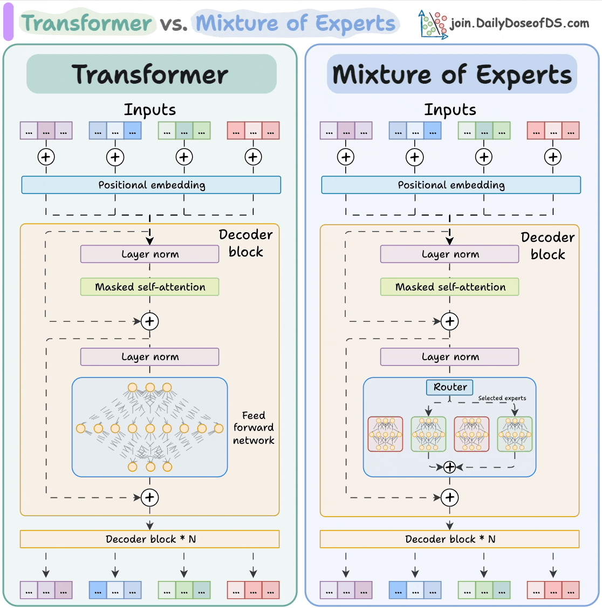
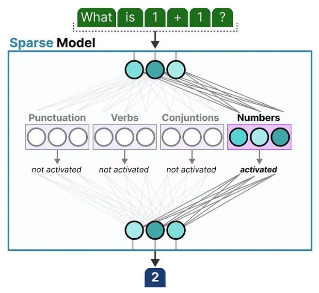
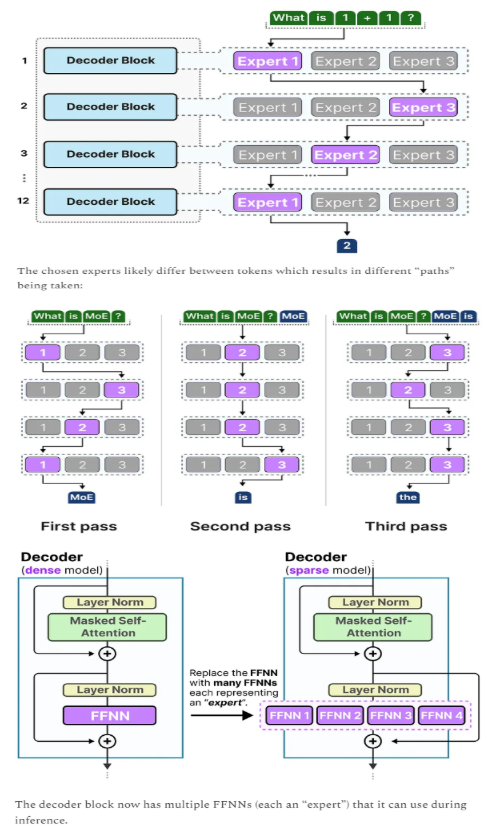

## Why Do We Need MoE?

- Traditional Large Language Model (a Dense Model, like Llama 3 70B), uses every single model parameter to process every single token.
- Not every input word/token needs all the model parameters for processing, so using 70 billion parameters(for a 70 billion param model) just to process a simple input token like "the" or "a" is just wasting compute.
- **The Scaling Bottleneck:** To make a dense model smarter (give it more knowledge capacity), you have to add more parameters. Adding more parameters linearly increases the computation (FLOPs) required per token, making training and serving exponentially slower and more expensive.

**Mixture of Experts (MoE) decouples model capacity (total parameters) from computational cost (active parameters)**

### Hospital Analogy: 
**Dense Model** is like a single generalist doctor who has read every medical textbook whereas **MoE Model** is like a hospital with 100 specialist doctors (Experts) and a triage nurse at the front desk (the Router), it holds the knowledge of 100 doctors (Total Parameters) but each patient requires only 1-2 doctors(active parameters).

Because only a small subset of the network runs for any given input, MoE models are called **Sparse Models**.

## Where Does MoE Live Inside a Transformer?

A standard Transformer Decoder Block has two main sub-layers:
* Self-Attention Layer: Allows parallel processing of tokens and capture long-range relationships.
* Feed-Forward Network (FFN / MLP): Processes each token independently to retrieve factual knowledge and transform representations. In a standard Transformer, ~2/3 of the parameters live inside the FFN.

**In most implementations, MoEs replaces ONLY the FFN layer.**

**MoE layer** has three fundamental parts: **The Experts**, **The Router** (Gate), and **The Combiner**.

**1. Experts:** Each expert is simply an independent Feed-Forward Network (FFN)-usually a SwiGLU MLP in modern LLMs (two linear projections up, a SiLU/Swish gating activation, and one linear projection down).

- Each token in this example is colored with the first expert choice (source: Mixtral of Experts paper, https://arxiv.org/pdf/2401.04088). 
- This visual also demonstrates that **experts tend to focus on syntax** rather than a specific domain. 

**2. Router (Gating Network):** The Router is a tiny, lightweight neural network (usually just a single linear layer with no bias) that determines which tokens are sent to which experts.

**3. Combiner:** 

# Jargon:
- FLOPs (floating-point operations): Measures the total math work required to train a model
- FLOPS (floating-point operations per second): Measures how fast hardware executes that math
- The "6N" Rule of Thumb: For dense transformer models, total training compute is commonly estimated as:  
> $Total FLOPs \approx 6 * N * D $

> where N=no.of parameters, D= no.of training tokens
- Projection Up: A linear layer (matrix multiplication) that maps the vector from the smaller model size(eg. 4096) up to a wider hidden size(eg. 11008)
- Projection Down: A linear layer that maps the vector from that wide hidden size(eg. 11008) back down to the original model size(eg. 4096)

# Resources:
- https://www.cerebras.ai/blog/moe-guide-router
- https://newsletter.maartengrootendorst.com/p/a-visual-guide-to-mixture-of-experts

